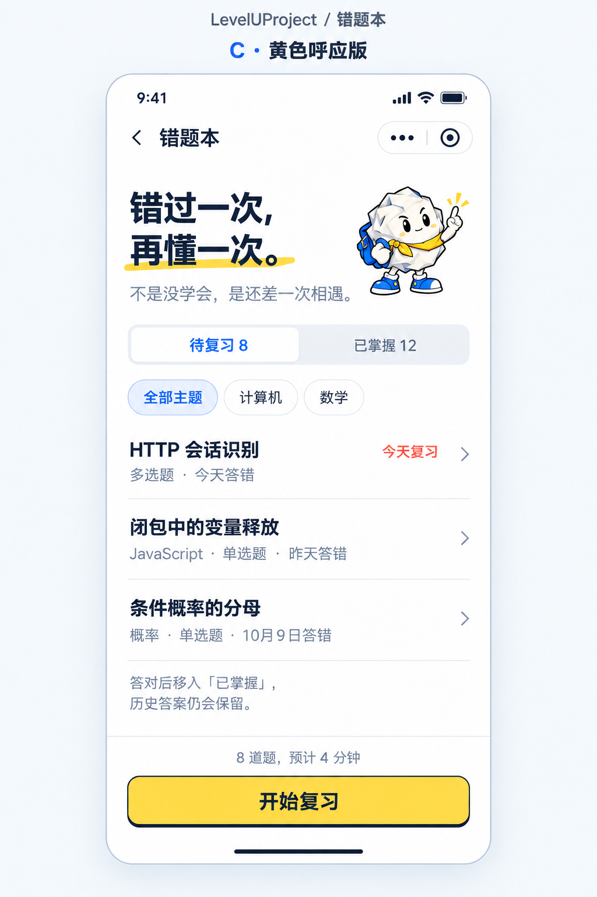

# C · 黄色呼应版

日期：2026-10-11
产品：LevelUProject
页面：错题本
状态：等待用户验收，未修改 HTML、CSS 或 JavaScript。

在上一轮简化列表的基础上，新增黄色方案：

- 主标题“再懂一次。”下增加黄色手绘划线。
- 底部“开始复习”恢复黄色填充、深墨色文字，采用较轻的描边及下沿。
- 标题划线、团团的黄色围巾和底部按钮使用同一黄色方向，形成上下呼应。
- 保留知识点标题、作答信息、筛选及吉祥物。

生成方式：内置 imagegen，编辑模式。
编辑目标：上一轮 A/B 错题本效果图中的左侧页面。
风格参考：用户提供的个人学习中心截图，只参考标题黄色划线与黄色按钮。
原始输出：C:/Users/20777/.codex/generated_images/01a12a13-a755-7b91-958c-99ff66b7e5f7/exec-44e93656-89fe-4e4e-9c6e-b615373db77b.png
完整提示词：[C版生成提示词.txt](C版生成提示词.txt)

确认后再进行 HTML 开发。

