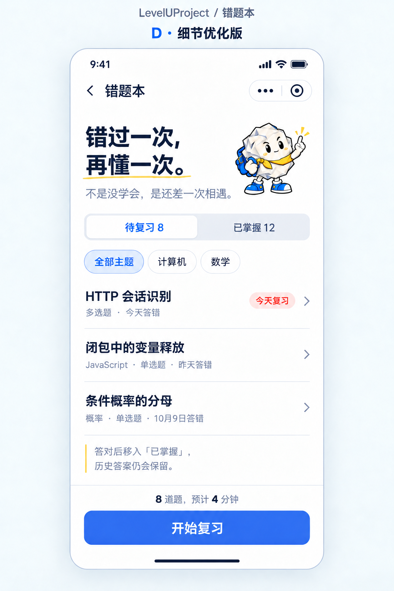

# D · 细节优化版

产品：LevelUProject
日期：2026-10-11
页面：错题本
状态：仅绘制效果图，等待验收；没有修改 HTML、CSS 或 JavaScript。

按用户提出的六点调整：

1. 黄色手绘下划线变细并下移，与标题及副标题留出间距。
2. 主按钮改为蓝色，白色“开始复习”文字。
3. “今天复习”使用浅红底小标签。
4. 底部说明左侧添加黄色竖线，与标题下划线呼应。
5. “8 道题，预计 4 分钟”仅将数字 8、4 加粗。
6. 题型、主题和作答时间采用较小字号，保持标题突出、列表疏朗。

保留已有团团吉祥物、筛选及列表结构。

生成方式：内置 imagegen 编辑模式；完成一轮绘制后，对划线和题目信息字号做一次局部精修。
参考：C版效果图与用户提供的新截图。
最终原始输出：C:/Users/20777/.codex/generated_images/01a12a13-a755-7b91-958c-99ff66b7e5f7/exec-f5d792fc-8daa-4a38-a66e-5ecb8c266c26.png
提示词记录：[D版生成提示词.txt](D版生成提示词.txt)

