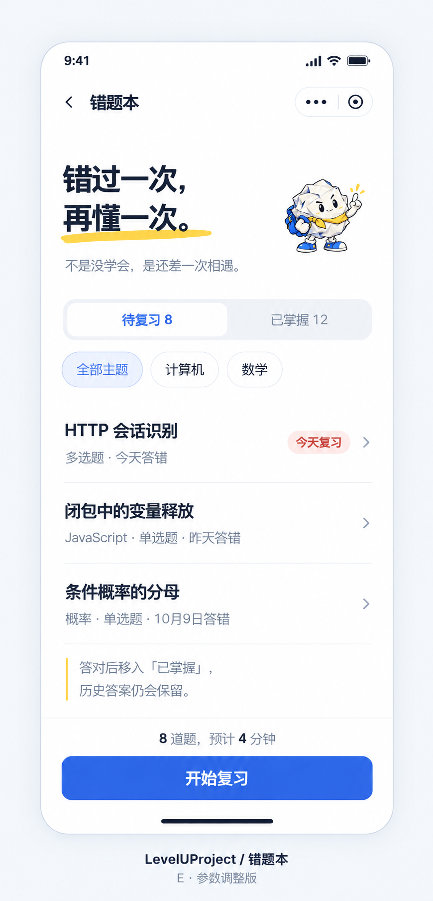

# E · 用户参数调整版

日期：2026-10-12
产品：LevelUProject
页面：错题本
范围：只绘制图片，没有修改用户发回的 HTML，也没有修改原型 HTML。

## 依据

以用户发回文件中的 CSS 参数为准：
D:/edge_download/错题本-D版-我的调整-20261012-083421.html

结合用户提供的截图，保留左侧错题本页面，绘制独立效果图，不展示右侧调节面板。

本轮用户保存的变化：
- 标题黄色下划线：8px。
- 标题黄色下划线下移：3px。
- 说明黄色竖线：2px。
- 题目行最小高度：80px。
- 标题与副标题间距：18px。
- 字号沿用文件数值：标题28px，副标题13px，知识点标题16px，题目信息12px，标签11px，说明12px，题量与时间12px，按钮16px。

保留蓝色按钮、浅红底“今天复习”标签、数字加粗、团团吉祥物及文字内容。

## 绘图记录

方式：内置 imagegen 编辑模式。
编辑目标：用户提供的最新截图。
辅助素材：已有团团吉祥物。
原始输出：C:/Users/20777/.codex/generated_images/01a12a13-a755-7b91-958c-99ff66b7e5f7/exec-780ec2b1-a1ba-4964-a72e-a4256c6b6de7.png

完整提示词：[E版生成提示词.txt](E版生成提示词.txt)
参数记录：[用户调整参数-20261012.json](用户调整参数-20261012.json)

