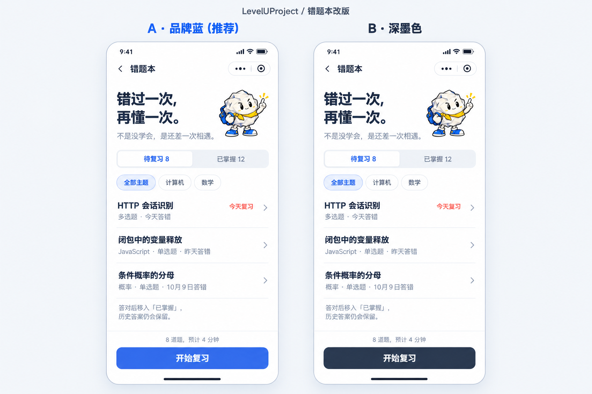

# 错题本改版验收稿

日期：2026-10-11
产品：LevelUProject
页面：R08 错题本
状态：等待用户验收。本轮没有修改 HTML、CSS 或 JavaScript。

## 设计结果

两版的内容和结构相同，仅比较主按钮颜色。推荐 A，沿用当前选中态的品牌蓝。

- 去掉重复的书本图标、彩色底块和重复的状态标签。
- 将问句式列表标题改为可快速识别的知识点标题：HTTP 会话识别、闭包中的变量释放、条件概率的分母。
- 次要信息保留题型、主题和作答时间；第一行以普通文字标明“今天复习”。
- 保留现有团团吉祥物、白色背景及页面顶部结构。
- 状态名称调整为“待复习 / 已掌握”，按钮文案调整为“开始复习”。
- 底部增加“8 道题，预计 4 分钟”；移除黄色按钮和厚重的黑色阴影。

## 拟采用样式

| 项目 | A（推荐） | B |
| --- | --- | --- |
| 主按钮 | #336AE8 品牌蓝 | #28364D 深墨色 |
| 按钮文字 | 白色 | 白色 |
| 按钮规格 | 高 50px，圆角 12px，无厚重描边和阴影 | 同 A |
| 正文主色 | #202A3D | 同 A |
| 次要文字 | #66758A | 同 A |
| 行分隔线 | #EDF0F5 | 同 A |

效果图属于视觉验收稿；确认后才将选定方向实现到 HTML。

## 参考与工具

- 设计插件检索已执行；Figma、MagicPath 在当前环境未连接，没有调用其设计画布或声称由其生成。
- 使用 ui-ux-pro-max 的局部 UX 检索，参考文字层级和对比度建议；未采用不相关搜索结果。
- 使用 frontend-design 已确定的整体视觉方向。
- 生成方式：内置 imagegen，编辑模式，参考用户截图与已有团团透明素材。
- [Quizlet Learn](https://quizlet.com/gb/features/learn)：参考针对薄弱内容开展短练习的任务组织方式。
- [Duolingo 错题复习](https://blog.duolingo.com/guide-to-duolingo-practice-hub/)：参考针对错题的复习入口与题量说明。
- [Ant Design Mobile List](https://mobile.ant.design/zh/components/list/) 与 [Button](https://mobile.ant.design/zh/components/button/)：作为移动端列表、按钮组件参考入口，未复制页面或组件源码。
- 本轮绘制只修改评审图片，原型开发文件保持原样。

## 生成记录

参考图 1：C:/Users/20777/AppData/Local/Temp/codex-clipboard-4ab90d58-de0d-4fec-90e5-70336f484ff3.png
参考图 2：D:/nbproject/LevelUpProject/prototype/assets/paper.png
原始输出：C:/Users/20777/.codex/generated_images/01a12a13-a755-7b91-958c-99ff66b7e5f7/exec-e015b464-525e-4ec1-9433-748286dc87e2.png

精确提示词见：生成提示词.txt

