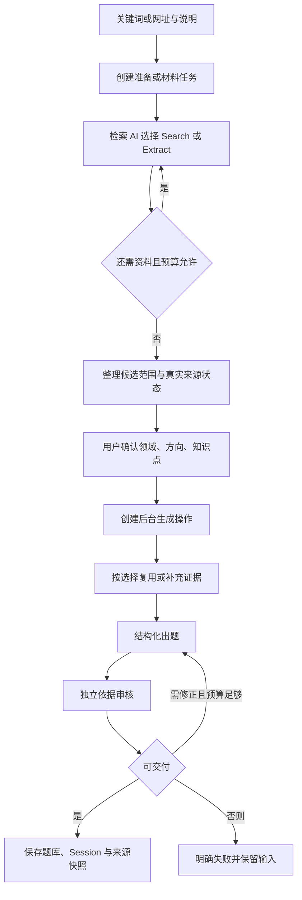

# Design

## Context

动机与已确认范围见 [proposal.md](proposal.md)。两份原始资源已全文阅读：需求文档要求联网补充，原方案将其延后；本次以实际实现而非旧 MVP 假设为基线。

| 已核对位置 | 现状及影响 |
| --- | --- |
| `README.md`、`frontend/package.json` | 维护 `frontend/`；Taro 4.3.0、React 18.3.1；漫画前端不参与。 |
| `backend/app/services.py` | 首页直接依赖模型知识，没有领域消歧和范围确认。 |
| `backend/app/materials/` | 已有文档/网页/视频解析、范围预览、材料分段、后台任务和来源 ID；网页使用 Jina Reader，搜索使用 Jina Search。 |
| `backend/app/llm.py`、`config.py` | LangChain ChatOpenAI 对接 DeepSeek，显式 JSON 输出；默认模型 `deepseek-flash`，保留部署配置。 |
| `backend/app/accounts/` | MySQL、服务端判题、幂等操作；默认每日 10 个关卡、每滚动 60 秒 3 次模型调用、每账号一个生成操作。 |
| `frontend/src/api.ts`、`features-api.ts` | 出题当前返回 Session，客户端请求超时 100 秒；已有操作查询可用于恢复。 |

2026-10-13 用户确认：优先 Tavily、每次确认范围、搜索失败自动回退并标注“未联网核实”；本轮进一步确认官方双工具、自主参数选择、国家偏向加城市关键词，以及有调用预算的后台任务方案。OpenSpec 主规格目前为空。

## Goals / Non-Goals

**Goals:**

- 由 AI 根据用户目标和实际工具结果自主选择搜索、读取网页、继续补充或结束检索，同时让程序执行范围、预算和权限约束。
- 关键词获得适当深度的资料，网址获得指定页面可访问正文；复杂度、语言、地域、时效分别决策。
- 来源可追溯、参数可验证、费用有界，任务可观察和幂等恢复；不再承诺固定三次模型调用。

**Non-Goals:**

- 不训练模型、不建向量库或长期公共知识库，不升级 Taro/React/FastAPI 或擅自更换模型。
- 不重做视觉、奖励和评分；不绕过登录/付费墙，不承诺完整还原动态页面、图片文字、评论区或整个网站。
- 不新增多供应商自动回退，不建立自定义复杂多 Agent 系统或独立 LangGraph 服务。
- 本次不实现代码、安装依赖或执行真实付费评测。

## Decisions

### 1. 使用官方双工具与一个受约束的检索 Agent

新增 `backend/app/quiz_grounding/`，承载结构模型、工具封装、检索编排、准备记录与接口；材料入口复用其工具和证据整理能力。增加并锁定与现有 LangChain 兼容的 `langchain-tavily`，使用：

- `from langchain_tavily import TavilySearch, TavilyExtract`
- `from langchain.agents import create_agent`，向同一个检索 Agent 注册两个工具，使用异步执行。
- 保留现有 ChatOpenAI/DeepSeek 配置。检索使用支持 tool calling 的原始模型客户端，范围结构化、出题和独立审核使用现有显式 JSON 网关；不能把已经 `with_structured_output` 包装的 Runnable 直接当作工具选择模型。

两项官方集成均提供异步与 Agent 示例：[Search](https://docs.langchain.com/oss/python/integrations/tools/tavily_search)、[Extract](https://docs.langchain.com/oss/python/integrations/tools/tavily_extract)。Agent 内部运行时依赖按锁文件解析，不再沿用旧方案“不使用 Agent”的限制，也不另建工作流服务。

Agent 只负责取得资料，不直接发布题库。工具把真实响应先登记为服务端证据，再返回受限内容供 Agent 判断下一步；最终自然语言总结不能凭空增加来源。两个工具可组合调用，程序不强制每次“先 Search 再 Extract”，也不要求有完整正文时重复提取。新关键词在联网可用时必须有实际检索尝试；指定页面必须有实际读取尝试才能声称已阅读。

工具提示描述适用输入、可调参数和剩余预算。程序在每次调用前校验账号操作、允许的材料范围、参数和预算；不允许模型修改凭证、服务地址、限流、来源状态或用户已经确认的领域。关闭材料补充时禁止 Search 和额外 URL，保留指定页面的读取能力。

工具调用失败统一规范为结构化结果，不直接把原始异常文本交给客户端。官方工具可能返回错误对象或 ToolException，不能只判断“未抛异常”就当成功。模型不支持 tool calling、持续无效调用等属于模型/配置错误，不能静默退回纯提示词并宣称实现了自主检索。实施前验证配置模型的工具调用能力；失败时报告原因，不擅自切换模型。

替代方案：固定 HTTPX 请求不满足自主调用及官方集成要求；直接把两个默认实例交给模型又无法动态控制所有必要参数。

### 2. 参数封装处理构造参数与调用参数的差异

保留 AI 可见名称 `tavily_search`、`tavily_extract`，在官方工具外增加薄的类型化封装，不自行重写 Tavily HTTP 客户端。AI 输入经白名单校验后，为每次调用构造独立的官方实例，并通过 `ainvoke` 执行；不改共享实例或全局环境变量。

| 工具 | AI 可选择的项目内参数 | 官方映射 |
| --- | --- | --- |
| Search | query、content_mode=summary/full、max_results、search_depth=basic/advanced、topic、time_range 或起止日期、include_domains/exclude_domains、country | content_mode 映射 include_raw_content=false/markdown；max_results、country 和正文开关在实例构造时设置，其余按该次选择设置一次，避免构造与调用冲突。 |
| Extract | urls、extract_depth=basic/advanced、content_mode=full/focused、可选 query、chunks_per_source | format=markdown 在构造时设置；full 不传 query/chunks_per_source；focused 需要 query，chunks_per_source 在构造时设置为 1–5。urls 通过调用传入。 |
| 两者的服务端控制 | 不提供给 AI 任意修改 | 凭证、端点、期限、调用预算、页面上限、正文预算；图片关闭，Search 合成 answer 关闭；可开启真实 usage 记录。 |

当前官方源码明确把 Search 的 `include_raw_content/max_results/country` 等列为仅构造参数；Extract 的 `format` 也有此限制。集成文档与当前源码对部分参数的覆盖优先级存在差异，因此只设置一处，实施时针对锁定版本检查实际请求，而非依赖默认覆盖顺序。[Search 源码](https://github.com/tavily-ai/langchain-tavily/blob/main/langchain_tavily/tavily_search.py)、[Extract 源码](https://github.com/tavily-ai/langchain-tavily/blob/main/langchain_tavily/tavily_extract.py)。

`auto_parameters=false`，本项目让 AI 自主决策、服务端校验，避免服务商再次自动改变成本参数。首版不透传任意 `**kwargs`，不把 REST 文档中新增但当前集成未验证的能力当成可用参数。记录模型请求参数、实际生效参数、调整原因码及返回状态；未知字段/无效组合返回可修正的工具错误，消耗尝试预算但不触发外部付费请求。

### 3. 动态检索策略与地域、语言处理

以下是提示与评估基线，不是按主题名称硬编码的路由；AI 根据证据覆盖决定升级或停止，所有选择受第 9 节硬上限约束。

| 情况 | 初始策略 | 进一步动作 |
| --- | --- | --- |
| 简单、稳定、含义清楚 | basic、summary、约 3 条结果 | 摘要足以支持目标则停止；缺必要条件或语境时提取对应页面。 |
| 新技术、复杂知识、多义词、需要比较 | advanced、full、约 5–8 条结果 | 在搜索响应直接请求正文；正文缺失或关键点未覆盖时选择原始 URL 提取，必要时调整查询。 |
| 用户指定网址 | 优先 Extract full；普通正文 basic，表格/复杂结构或首次不足时 advanced | 原页面为主；仅在允许补充时搜索术语、原始出处或反证。 |
| 热梗与名场面 | 按原语言搜索语境、出处、含义；通常 general | 同时考虑旧的原始内容和后续讨论；“新/热”不自动等于 news 或最近一天。 |
| 明确关注最新动态 | 依据目标选择时间范围；确属新闻时可选 news | 区分发布时间与检索时间；保留支撑定义所需的经典资料。 |

max_results 允许 1–10；3、5–8 是建议值，AI 可按知识点数量、方向不确定性和来源覆盖调整。不能以结果条数等同可信度；无新增信息时停止重复查询。长输入由 AI 提取关键词和范围，不再机械截取首句；完整输入仍用于理解，实际查询在确认页可查看。

回答语言、资料语言和地域分开：

- 用用户原词、原语言和术语原文优先检索；需要国外原始资料时生成英文/当地语言查询，必要时在预算内组合中外来源，答案仍遵守用户语言偏好。
- 全球通用知识默认 country 为空。只有学习目标包含地域要求时，按明确目标设置国家偏向；不用中文输入推断中国所在地，不根据 IP 自动推断城市。
- Tavily 的 country 是国家结果偏向，仅适用于 topic=general，不是严格国家过滤；不向 API 传不存在的 city 参数。城市使用地名、国家及必要同名地消歧组成 query，并核对页面内容是否涉及目标地域。
- topic=news/finance 时移除不适用的 country，并在查询中保留地域意图。用户明确的城市/时间约束不能因结果少而静默放宽；未能取得当地资料应报告不足。非强约束的来源偏好可在预算内调整。
- 不将一个国家的资料语言等同于其全部来源；include_domains 是限制而非真实性证明，技术定义优先官方/原作者，文化语境优先原始出处与可核对讨论。

国家能力见 [Tavily Search API](https://docs.tavily.com/documentation/api-reference/endpoint/search)。城市策略为用户已确认的应用层设计，不能在 UI 中标注为“已严格按城市筛选”。

### 4. 网址输入、全文与既有材料流程

首页识别有效 HTTP(S) URL，可带学习说明；识别用于提供材料入口及保留意图，不用 URL 字面猜测页面内容。纯网址进入网页材料准备，显式保留联网补充开关；包含网址的学习说明同样优先读取该页，再按开关决定是否扩展。首版不因此新增批量网址导入或整站爬取 UI，工具批量读取仅用于本次检索中的少量页面。

材料网页读取从 Jina Reader 迁移为官方 TavilyExtract；文档解析和视频字幕仍复用现有适配。关闭补充时，读取用户指定网页是取得原材料，不是扩展搜索；程序限制工具只能读该指定地址及其合法公开跳转，不跟随正文链接继续读其他材料。开启补充后，AI 可以 Search 和 Extract，范围围绕已选材料知识点；原材料与补充片段分开保存。停止使用 Jina Search/Reader 作为这两条新路径的隐式备选，配置清理只针对确无调用的项目。

“整个页面”指指定 URL 能被服务读取的页面正文，不只是搜索摘要。full 提取不带 query 或 chunks_per_source，避免 API 按相关性只返回少量片段；focused 只适用于补充资料的定向读取，不能冒充指定页面完整读取。API 的按 query 返回片段行为见 [Tavily Extract API](https://docs.tavily.com/documentation/api-reference/endpoint/extract)。

分开记录两种完整性：

1. 获取状态：实际返回全文模式、摘要、定向片段、部分失败或无法判断完整性；raw_content 非空不代表网页所有内容都已获取。
2. 使用状态：原始返回正文在体积上限内保存，按段落/标题切分与哈希；模型只接收相关片段，记录未覆盖知识点及截断情况，不把 24000 字上下文预算解释为页面只有这些内容。

返回 200 也逐个检查 results 与 failed_results。单页失败不丢弃其余成功来源；空正文可以在预算内升级深度。登录墙、动态内容缺失、超限、无法读取均明确展示，不宣称已经阅读。只有网址且页面不可读时返回可操作的材料读取失败，提示补充主题/正文；用户同时提供足够主题时可走未核实范围确认，但不把页面列为已读来源。

### 5. 流程、接口与用户确认

准备、生成沿用“数据库状态 + FastAPI BackgroundTasks + 查询”的模式。它不是持久队列，不承诺进程重启后自动续跑；重启中断最终转明确失败/过期并可重新提交。为等待模型额度使用异步可取消等待，仍受整体期限约束。参见 [FastAPI BackgroundTasks](https://fastapi.tiangolo.com/tutorial/background-tasks/)。

Agent 检索后由一次独立 JSON 调用产生候选领域、方向、知识点及证据映射。无依据候选可用于消歧，但标识 unverified；模型无法整理有效范围则失败。人工等待期间释放账号操作占用。每次新生成必须提交明确选择；不以客户端可伪造的 confirmed 布尔值替代版本和所有权校验。

全部接口沿用认证和 `{code,message,data}`：

| 接口 | 契约 |
| --- | --- |
| POST /api/v1/quiz/preparations | 关键词 `{text}`，1–6000 字，Idempotency-Key；HTTP 200 返回记录。网址输入由前端引导到网页材料准备，后端同样识别并返回明确材料入口提示，不能把网址静默当普通关键词。 |
| GET /api/v1/quiz/preparations/{id} | 本人的状态、阶段、原因、retry_after_seconds、就绪范围、来源概况、版本及有效期。 |
| POST /api/v1/quiz/preparations/{id}/cancel | 幂等取消未完成准备；终态不可被迟到响应更改。 |
| POST /api/v1/quiz/generate，主题模式 | preparation_id、scope_version、candidate_id、focus_id、scope_point_ids、question_count、difficulty；校验后 HTTP 200 返回操作对象，不同步等待 Session。 |
| POST /api/v1/quiz/generate，材料模式 | 保留 material_id/point_ids/supplement；新增可选 execution=background，维护中的前端用后台模式。旧材料客户端不传该项仍返回 Session，遵守旧 90 秒预算，不能无限等待。 |
| GET /api/v1/operations/{key} | 在原有操作结果结构上增补阶段、等待时间和期限；成功结果仍为现有 Session，失败为稳定错误码。客户端读取此处完成恢复。 |

文本、材料、主题准备三类输入互斥；旧纯 text 请求返回 SCOPE_CONFIRMATION_REQUIRED（409）。材料 point_ids 仍指原材料分段；主题 scope_point_ids 不能混用。网页上传/解析接口继续返回现有材料任务结构，新增可选学习说明随材料保存；全套字段及两类出题返回类型必须写入 OpenAPI 和客户端类型。

新生成在占用关卡额度前验证本人、ready、未过期、版本、各层选择归属及题目设置。其他账号记录统一 404；过期 409；同键不同摘要返回 IDEMPOTENCY_CONFLICT。摘要包含来源模式、完整确认、设置、补充开关及执行模式。

幂等查询先确认账号与摘要、再恢复原状态/结果；只有新操作校验准备有效期。成功结果不依赖临时准备记录存活。进程内重复提交不启动第二份任务，数据库 reserve/提交事务负责竞争，不依赖前端防抖。

### 6. 准备记录、来源快照与完整性

迁移接在现有 `003_materials_analytics` 后，增加 `topic_preparations`、每日额度中的 `topic_prepare_count`，并为操作增加阶段、期限和可计算等待信息。材料复用原有表和解析额度口径，不因首页网址入口重复创建主题准备。

准备记录含 id/user_id/key/digest/status/stage/version/input_text/content/error_code/created_at/expires_at/operation_id；content 保存已验证查询、来源、候选范围和有效参数摘要，不保存模型隐含推理。唯一键 (user_id,key)，账号删除级联清理。更改输入创建新版本记录，不覆写原快照。

状态 running → ready/failed/cancelled/expired；阶段包括 planning/searching/extracting/summarizing/waiting_rate_limit。生成操作沿用 running/succeeded/failed 终态口径，增加 retrieving/generating/reviewing/waiting_rate_limit 阶段。每次发起调用、写库和发布结果前检查任务状态、租约、账号与期限。准备成功、内容保存、操作结束在同一事务；取消与完成通过条件更新决胜。

| 对象 | 保存的信息 |
| --- | --- |
| Quiz.learning_scope | 原主题/用户说明、规范主题、领域、方向、知识点、准备 ID 和版本；材料保留已选范围。 |
| Quiz.grounding | source_backed/unverified/material_only、原因码、供应商、真实检索/提取时间、检查版本；状态由程序决定。 |
| Question.grounding | 逐题支持状态与原因，错题组合仍可追溯。 |
| Quiz.source | 支持 type=topic，material_id 可选；材料保持真实材料 ID，不为主题伪造材料。 |
| 来源与片段 | 服务端 ID、标题、原始/实际返回 URL、真实文本、snippet/full_extract/focused_extract 等内容种类、原文日期或未知、获取时间、哈希、获取/截断状态、材料页码或字幕时间、补充标识。 |
| 工具执行记录 | 工具名、调用 ID、有效参数、结果/失败数量、耗时、真实 usage（若返回）、结束原因；与操作关联，敏感正文不写运行日志。 |

成功题库复制所用真实片段与范围，后续不依赖准备存活。不建跨账号缓存；同一操作复用已保存的工具结果，同键重放不再次联网。新操作引用同一准备且资料少于 30 分钟时可复用；确认方向未覆盖时仍需定向补充。超过 30 分钟必须刷新用于本次确认范围的证据；刷新失败保留原时间并走未核实规则，不把旧资料标成刚核实。

历史可缺省新增字段，显示“历史题目未记录联网核实状态”。错题复制逐题标识，并以原题库 ID 给来源 ID 加命名空间，避免不同题库的 s1 相互覆盖。

### 7. 出题和独立依据检查

Agent 取得的正文先按 URL/文本哈希去重、分段并按所选领域和知识点分配上下文预算。摘要也可支撑简单事实，但只认实际文本；有 raw_content 不等于有正确答案。争议归属需独立来源交叉核对，转载同文不算独立；明确官方定义可以由原始来源支撑。不可消除的争议应变成有来源限定的理解题或改用其他知识点。

新增版本化检索、范围、依据出题、降级和审核模板。范围/生成/审核使用 ChatPromptTemplate 与现有 JSON 网关，保留 Pydantic v2 跨字段、空输出、截断和题型配比检查；不在其结构化输出调用中继续联网。[LangChain 模型](https://docs.langchain.com/oss/python/langchain/models)、[Pydantic 校验](https://docs.pydantic.dev/latest/concepts/validators/)、[DeepSeek JSON](https://api-docs.deepseek.com/guides/json_mode/)。

内部 QuizDraftResult 区分 ready（合法 QuizContent）和 insufficient_knowledge（原因，无题目）；不足时明确失败，不为了满足 3/5 题硬造题。生成按确认方向组织，具体方向至少过半题实质覆盖；热梗资料充分时至少两个不同梗/场面，不用节目名、嘉宾名称凑数。

独立审核仅接收确认范围、题目和登记的真实片段，无网络工具，检查事实、答案、讲解、合理干扰项及方向覆盖：

| 审核结果 | 程序处理 |
| --- | --- |
| supported | 同时要求引用 ID 存在且片段支持结论，才标有来源支持。 |
| unsupported | 无已知矛盾、结构和方向有效时标未核实，去除误导性引用；任一题未核实则整组未联网核实。 |
| contradicted/ambiguous/off_scope | 只在有完整“修正 + 再审核”预算时修正；仍不通过则 QUIZ_QUALITY_FAILED，不能换标签放行。 |
| 审核失败或格式无效 | 按模型错误/预算规则结束，不能把未审核当作通过。 |

降级审核不能凭模型知识把无证据题升级为 supported；只检查范围、内部一致性和现有材料可证明的部分。未核实出题不声称最新、最热或精确热度。真人验收仍必要，模型审核不是绝对正确证明。

### 8. 失败与自动降级

| 情形 | 行为 |
| --- | --- |
| Tavily 未配置、认证/额度/限流错误、超时、服务故障、全空结果 | 保存标准化原因；有明确主题时自动准备/生成未核实内容，不增加降级确认。 |
| 一部分 Search 结果无正文或 Extract failed_results 非空 | 保留其他成功证据，由 AI 在剩余预算中决定继续读取；不把整个 HTTP 200 当作全部成功。 |
| 工具次数用完但仍有有效证据 | 停止检索，按真实覆盖进入范围整理/生成；不足部分按未核实规则处理，不允许无限循环。 |
| 仅网址、原页面读不到 | 明确需要补充学习主题或正文；不依据 URL 猜页面内容，不伪造材料。 |
| 页面部分可读 | 展示缺失/不完整状态，范围只覆盖已取得内容；有明确额外主题且允许补充时可检索它。 |
| 材料补充失败 | 优先所选原材料，标识“联网补充失败，未联网核实”；原材料不足则失败，不用无关常识填满。 |
| 材料主动关闭补充 | 仅原材料，标 material_only；不是服务故障。 |
| 输入/权限/数据库/账号配额/取消/到期/模型错误 | 相应失败或合法等待，不能通过知识降级绕过控制。 |
| 确定矛盾/严重歧义/偏题 | 修正并重审或失败，不能仅改标签。 |

降级状态在确认、讲解、报告、历史和错题中一致；复盘不能把未核实知识改写为已核实新事实。来源状态不改变服务端评分、奖励和个人统计口径。

### 9. 调用预算、后台等待与幂等恢复

以下为用户确认的实施初始配置，可调但必须经过配置校验；上限不是每次必须用满的目标：

| 配置 | 初始值与语义 |
| --- | --- |
| TOPIC_PREPARE_DAILY_LIMIT | 每账号每日 20 次新主题准备，同键不重复计数；网页材料按既有解析额度计数。 |
| TOPIC_PREPARE_TIMEOUT_SECONDS | 240 秒，包含检索、模型整理、重试及额度等待；网页读取链同样有该阶段上限。 |
| GROUNDED_GENERATION_TIMEOUT_SECONDS | 后台生成 300 秒；旧同步材料请求仍至多 90 秒。 |
| PREPARE_MODEL_CALL_LIMIT | 每阶段共 5 次实际模型请求，包含检索规划、整理与所有重试。 |
| GENERATION_MODEL_CALL_LIMIT | 每阶段共 7 次实际模型请求，包含追加检索、出题、审核、修正和重试。 |
| RETRIEVAL_MODEL_CALL_LIMIT | 每次阶段中的检索 Agent 至多 3 次模型请求，包含继续判断及最终回复；并受阶段剩余额度约束。 |
| RETRIEVAL_TOOL_CALL_LIMIT | 每阶段 Search + Extract 共至多 4 次尝试；错误参数、失败和重试均计数，缓存命中不发外部请求。 |
| SEARCH_MAX_RESULTS | 每次 1–10，AI 动态选择；建议简单 3、复杂 5–8。 |
| EXTRACT_MAX_URLS_PER_CALL | 每次至多 3 个 URL；同阶段按实际外部调用计页面尝试，最多 12 次；重复或升级提取仍计入。 |
| TAVILY_TIMEOUT_SECONDS | 单次调用至多 20 秒，并受阶段剩余期限限制。 |
| TOOL_RESULT_MAX_BYTES / EVIDENCE_MAX_CHARS | 工具返回序列化后保留上限 2 MB；每次模型上下文中的工具证据/真实片段合计至多 24000 字，超出分段筛选并记录截断。 |
| TOPIC_PREPARATION_TTL_HOURS / EVIDENCE_REUSE_SECONDS | 准备 24 小时有效；1800 秒为新生成证据复用期。 |

工具返回体积是应用层接收后的保留/入模上限，不虚称官方 SDK 提供了 2 MB 的底层流式网络限制。限制结果条数、页面数及全阶段上下文总量，不能每个工具分别塞满 24000 字后无限累积；选择覆盖目标的片段，缺失覆盖明确报告。完整正文未超保存上限时可以保留供预览，不能因入模截取丢失真实来源状态。

账号滚动 60 秒 3 次实际模型调用的限制不提高。每次真实请求前统一原子记账，Agent 的规划/继续、结构化输出、审核、修正、测试注入 runner 全部经过同一入口；禁用 SDK/中间件未记账的隐式模型重试，不把一次 Agent 运行只计一次。prepare 操作不扣 quiz_count；正式生成首次实际模型请求（包括其检索规划）按既有规则扣一次关卡，后续不重复扣。

保留账号一个操作租约。工具只在合法操作内启动，外部调用前检查模型后续步骤仍有预算；没有生成+审核预算就不继续付费检索。准备为范围整理至少保留一次请求；生成为出题+审核至少保留两次。初始 7 次允许至多 3 次检索规划加一次生成/审核，再加一次修正/重审；结构重试占用相同余额，不能另开隐藏预算。

使用官方 ModelCallLimitMiddleware/ToolCallLimitMiddleware 作 Agent 内部上限，外层持久操作计数覆盖重试、并发工具批次和阶段总量，二者不代替账号限流。工具批次逐项原子占用次数并限制同一操作的执行并发，超出的调用不得发出。全局工具超限使用可控停止路径，不采用只适用于单工具的 end 假设。[LangChain middleware](https://docs.langchain.com/oss/python/langchain/middleware/built-in)。

分钟额度不足时，后台阶段标 waiting_rate_limit，计算 retry_after_seconds，在同一任务内异步等待，不新建操作、不重跑已完成工具、不重复扣关卡；取消/注销/期限到达立即停止后续动作。等待期间仍保留该操作租约，避免新操作同时运行；前端允许离开并恢复。若剩余期限不足以等待并完成后续必要步骤，则明确超时/限流失败；旧同步材料请求不能容纳等待时返回可重试错误。阶段到期不是绕过模型额度使用知识降级的理由。

租约至少覆盖阶段期限加 15 秒结算余量，结束/失败/取消事务释放。前端请求不等待 300 秒：创建操作立即返回，按真实状态有限退避轮询；失去响应先恢复原幂等键，不能用新键重复出题。未完成准备可服务端取消；正式生成“返回首页”表示离开页面，后台继续，不虚称已撤销调用。

BackgroundTasks 不保证跨进程续跑；进程中断/租约过期后记录明确失败，重试使用新操作。避免同键重新调度已经失去执行权的任务；迟到工具响应和模型结果必须通过状态条件写入。已成功 Session 可在准备过期后继续恢复。

### 10. 前端、数据隔离与材料兼容

新增 TopicFlow 复用现有材料卡片和选择组件；首页增加 URL 识别和明确网页材料入口。状态包含输入、资料获取、等待额度、范围确认、生成、失败。进度来自后台事件，不用伪百分比；只展示简短操作说明、查询、来源及参数产生的用户可理解效果，不暴露 Agent 内部推理。

确认页可以预览已取得学习资料、切换领域/方向/知识点、返回改写。生成提交必须是显式确认；切换目标生成新操作键，旧回包不得覆盖当前选择。材料前端使用新增后台执行模式，旧同步客户端继续识别 Session/标准业务错误；新类型按执行模式区分，不把操作对象当 Session 解析。

按操作维护请求句柄，Taro RequestTask.abort 只终止客户端网络请求；账号 epoch 防止旧账号回包进入新账号。轮询取消不能错误地取消服务端生成或其他页面请求。[Taro request](https://github.com/nervjs/taro-docs/blob/master/docs/apis/network/request/request.md)、[RequestTask](https://github.com/nervjs/taro-docs/blob/master/docs/apis/network/request/RequestTask.md)。

未作答题目不下发答案、讲解、审核理由和逐题 source_ids，来源列表只展示已答题有效引用；确认页本来可预览的学习资料除外。后台操作查询也执行相同 Session 序列化，不新增答案旁路。

搜索只传本次必要查询，不附账号资料、历史或上传材料全文；Extract 传需要读取的公开 URL。页面提示关键词/指定网址将发送给检索服务。密钥只在后端；工具日志不记录凭证、全文或答案。取得和展示 URL 均做协议及公开地址校验，拒绝本地/内网/带凭证地址；若服务端直接读取或跟随跳转，沿用已验证 IP 与重定向检查，不能把官方工具调用当成对任意 URL 的信任。公网提取仍只认真实返回内容。

输入材料和网络正文都是不可信数据；不能更改系统规则、工具预算、补充开关、检索端点或账号身份。清理与注销覆盖任务、证据、工具执行记录，迟到结果不能复活账号数据。

### 11. 验证方法与验收标准

测试以行为及实际请求为准，不只断言工具工厂被调用：

- 依赖/工具契约：锁定官方包后检查 ainvoke、实际构造参数、Search 正文开关/max_results/country、Extract 全文与 focused、空结果/错误对象/部分失败；并发两账号不串参数，未知参数及不适用组合在外部调用前阻止。
- 自主选择：固定工具响应下验证关键词选搜索、指定页选提取、摘要不足再提取、已有正文不重复读取、动态结果数、复杂结构深度升级，以及工具/模型预算耗尽时停止。允许不同有效顺序，不能把一条固定顺序当成唯一正确答案。
- 范围和证据：两个原始用户例子、材料开关、外文原始资料、全球/国家/同名城市、引用不支持/矛盾/伪造、截断与未知日期；注入内容不能修改工具规则。
- 可靠性：每次真实模型请求计数、保留生成审核预算、额度等待、取消/注销/迟到结果、重启中断、原键恢复及准备清理后的成功结果；新后台模式和旧同步材料返回均有契约测试。
- 前端/集成：双输入、每次确认、未核实标签、进度与限流等待、断网/换号恢复、来源反馈、报告/错题/历史，H5 与微信小程序回归。

实施阶段至少 20 次真实完整生成，覆盖 Harness Engineering、花少2、新技术、同名歧义、稳定知识；两个用户样例各至少 3 次。矩阵同时包含至少 4 次网址学习、至少 4 次需要英文/双语资料的学习，以及全球/国家/城市各至少 1 次（维度可重叠）；另测不可读与复杂网页。记录真实参数、调用链、来源、时间、所选范围、费用/时延与人工判定，不用替身结果代替联网质量。

20 次至少 18 次形成结构有效且符合范围的结果；两个用户样例不得切换领域，热梗在资料充分组中至少过半题有实质语境、覆盖至少两个不同梗/场面。所有标有来源支持的验收题逐题人工核对，不以总体成功率抵消错误引用。单列有来源成功率、降级比例、页面读取状态和参数策略效果，降级不计为联网成功。

中文覆盖不足先改查询、来源和深度策略；仍不达标保留失败证据并与用户决定替代服务，不擅自换供应商。付费验证留到实施阶段，未执行不得声称效果已验收。

## Risks / Trade-offs

- [Agent 增加调用和等待] → 5/7 次阶段上限、现有分钟限流、后台进度及有界等待；记录实际用量再调参。
- [网页“全文”无法保证完整] → 区分获取和入模截断，保留实际正文，未取得内容不参与已核实题。
- [官方文档与 SDK 参数行为存在差异] → 使用锁定版本、每次独立实例和实际请求契约测试；不使用未验证参数。
- [国内外来源覆盖不均或地域偏向不严格] → 按主题语言和来源选择，核对城市语境，真实样例验收。
- [自动降级与模型审核仍可能有误] → 透明标签、真实片段、独立审核和人工抽查；确定错误不能发布。
- [后台任务不跨进程续跑] → 期限与终态、幂等恢复、新键重试，不宣称可靠队列语义。
- [接口返回模式变化] → 主题联动发布，材料后台模式显式选择，保留旧 Session 兼容测试。

## Migration Plan

1. 锁定官方 Tavily 包及 Agent 依赖，验证现有 DeepSeek 配置支持工具调用，不擅自换模型或升级框架。
2. 增量迁移准备、操作进度和额度，新增可选题库来源字段；验证空库、已有材料/历史及注销。
3. 接入官方双工具，配置 Tavily 凭证与预算；网页 Reader 和材料补充统一迁移，验证视频/文档原有解析不受影响。
4. 前后端联动发布主题确认与后台返回；材料使用显式后台模式，旧同步契约仍测试。同步 OpenAPI、README、错误码及供应商配置说明。
5. 完成离线回归、H5/小程序及真实服务评测。缺密钥只验证降级，不算联网验收。
6. 回滚通过功能开关暂停新主题/新后台生成，保留兼容读取新快照的版本与数据。网页工具暂不可用明确失败，不静默切回其他供应商；不做破坏性数据库降级。

## Documentation Verification

2026-10-13 已完整阅读用户提供的两篇 LangChain Tavily 集成文档，通过 Context7 补充参数和 Agent 用法，并核对官方源码与 Tavily Search/Extract API。现有技术栈文档已通过 Context7/官方来源核对：Taro、LangChain、FastAPI、Pydantic、DeepSeek；不把示例中的其他模型替换进项目。

现有锁定依赖基线：FastAPI 0.143.0、LangChain 1.4.4、langchain-openai 1.7.0、Pydantic 2.14.1、HTTPX 0.28.1。新增包的精确兼容版本在实施时解析并锁定，契约测试针对实际安装版本；本次未安装依赖、调用真实 Tavily/DeepSeek 或实现业务。

产品与架构选择已由用户确认。密钥、中文覆盖、页面完整性、实际时延及费用是明确的实施验收项，不作为已成功的假设。
